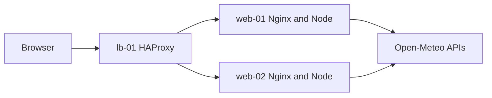
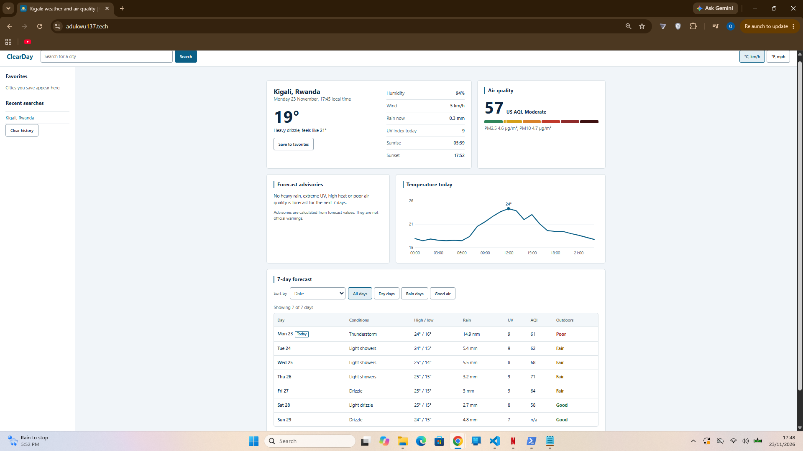
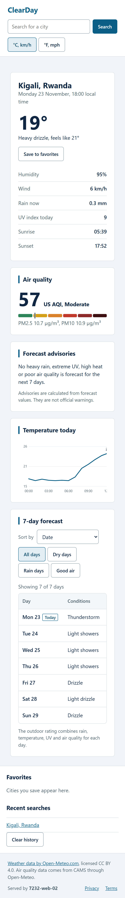

# ClearDay

[](https://github.com/adukwu137/clearday-weather-planner/actions/workflows/ci.yml)

ClearDay is a weather and air quality planner. Search any city, see the current weather, a 7-day forecast and air quality, and get an outdoor rating for each day so you can plan walks, sports, travel or errands.

The app runs as a small Node.js server on two web servers behind a load balancer. The server calls the Open-Meteo APIs, caches the answers, and serves a plain HTML, CSS and JavaScript frontend.

| | |
|---|---|
| Live site (through the load balancer) | https://www.adukwu137.tech (also reachable at http://3.10.24.245) |
| Demo video (under 2 minutes) | ADD DEMO VIDEO LINK HERE |
| Source code | https://github.com/adukwu137/clearday-weather-planner |
| Login or API key needed | None. See [Credentials](#credentials) |

## Features

- **City search** with a list of matches when a name is ambiguous, and a clear message when nothing matches.
- **Current weather**: temperature, feels-like, conditions, humidity, wind, rain, UV index, sunrise and sunset.
- **Air quality**: US AQI with a category, a six-band scale, PM2.5 and PM10.
- **7-day forecast table** you can **sort** (date, highest temperature, most rain, best air quality, best for outdoors) and **filter** (all days, dry days, rain days, good air).
- **Outdoor rating** (Best, Good, Fair, Poor) for each day, combining rain, temperature, UV and air quality.
- **Forecast advisories** for heavy rain, extreme UV, high heat and poor air quality. They are calculated from forecast values and labelled as not official warnings.
- **Hourly temperature chart** for today.
- **Favorites and recent searches**, saved in the browser. Units (°C and km/h, or °F and mph) are remembered too.
- **Error handling**: invalid input, city not found, network failure, API downtime, rate limiting and malformed API data all produce a plain message with a Retry button where it helps. If the weather service is down, the last saved data is shown and marked as saved.
- **Server name in the footer** ("Served by 7232-web-01" or "7232-web-02"), which makes the load balancing visible.
- **Accessible**: keyboard operable, visible focus, labelled controls, live regions for status messages, responsive down to phone width.

## How it works



- The browser only talks to ClearDay. It never contacts Open-Meteo directly.
- Each web server runs Nginx on port 80, which passes requests to the Node app on `127.0.0.1:3000`.
- The Node app validates input, calls Open-Meteo (geocoding, forecast and air quality), caches the results in memory, and turns the raw data into the report the page shows.
- HAProxy on lb-01 shares requests between web-01 and web-02 with round robin and checks `/api/health` on both.
- The two servers do not share state. Favorites, history and units live in the browser, so it does not matter which server answers a request.

## APIs and credits

ClearDay uses three endpoints of **[Open-Meteo](https://open-meteo.com/)**. No API key is required.

| Purpose | Endpoint | Documentation |
|---|---|---|
| City search | `geocoding-api.open-meteo.com/v1/search` | https://open-meteo.com/en/docs/geocoding-api |
| Weather forecast | `api.open-meteo.com/v1/forecast` | https://open-meteo.com/en/docs |
| Air quality | `air-quality-api.open-meteo.com/v1/air-quality` | https://open-meteo.com/en/docs/air-quality-api |

- Weather data by [Open-Meteo.com](https://open-meteo.com/), licensed under [CC BY 4.0](https://creativecommons.org/licenses/by/4.0/). The credit and link appear in the app footer.
- Open-Meteo's free service is for non-commercial use and asks users to stay under 10,000 requests a day. See its [terms](https://open-meteo.com/en/terms). ClearDay caches responses to stay far below that.
- Air quality data comes from the Copernicus Atmosphere Monitoring Service (CAMS) through Open-Meteo.
- Weather condition names follow the WMO weather interpretation codes used by Open-Meteo.
- The server uses only Node.js built-in modules. The frontend uses no libraries, fonts or images from other sites.

## Run it locally

You need [Node.js](https://nodejs.org/) 20 or newer. There is nothing to install with npm.

```bash
git clone https://github.com/adukwu137/clearday-weather-planner.git
cd clearday-weather-planner
npm start
```

Open http://localhost:3000.

Run the tests with `npm test`. They use a fake Open-Meteo server, so they need no internet connection.

### Configuration

Set these as environment variables or in a `.env` file (see `.env.example`). All are optional.

| Variable | Default | Meaning |
|---|---|---|
| `PORT` | `3000` | Port the app listens on |
| `HOST` | `127.0.0.1` | Address the app listens on |
| `CACHE_TTL_SECONDS` | `600` | How long weather and air quality answers stay fresh |
| `RATE_LIMIT_PER_MINUTE` | `120` | Requests per minute allowed per visitor on `/api` routes |
| `SERVER_NAME` | machine hostname | Value of the `X-Served-By` header and the footer label |


## Deploy to the web servers and the load balancer

The servers are web-01 (`18.171.204.227`), web-02 (`18.171.160.168`) and lb-01 (`3.10.24.245`).

### 1. Web servers (repeat on web-01 and web-02)

```bash
ssh ubuntu@18.171.204.227        # then 18.171.160.168
git clone https://github.com/adukwu137/clearday-weather-planner.git ~/clearday
cd ~/clearday
bash deploy/setup-server.sh
```

`setup-server.sh` installs Node.js 20 and Nginx, installs `deploy/clearday.service` (a systemd unit that keeps the app running and restarts it if it crashes), installs `deploy/nginx-clearday.conf`, and starts everything. It also moves Nginx's default site to `/etc/nginx/default-site.backup`. The app listens only on localhost, so the firewall only needs ports 22 and 80 (and 443 on the load balancer).

Check each server directly:

```bash
curl http://18.171.204.227/api/health
curl http://18.171.160.168/api/health
```

Each answers with its own server name.

### 2. Load balancer (lb-01)

Compare `/etc/haproxy/haproxy.cfg` with `deploy/haproxy.cfg.example` and edit the frontend and backend you already have, keeping the existing `global` and `defaults` sections. The result should:

- send requests to a backend containing both web servers with `balance roundrobin`;
- check `GET /api/health` on each server (`option httpchk`), so a stopped server is taken out of rotation and returned when it recovers;
- pass the visitor's IP to the web servers with `option forwardfor`. Nginx trusts that header only when it comes from the load balancer (`set_real_ip_from` in `nginx-clearday.conf`);
- redirect HTTP on `www.adukwu137.tech` to HTTPS, and send the bare domain `adukwu137.tech` to `https://www.adukwu137.tech`, using one Let's Encrypt certificate that covers both names (the commands are in the comments of the example file).

Then check the configuration and reload:

```bash
sudo haproxy -c -f /etc/haproxy/haproxy.cfg
sudo systemctl reload haproxy
```

DNS: `www`, `lb-01` and the bare `@` record all point at the load balancer (`3.10.24.245`), so no public address bypasses it. `web-01` and `web-02` point at their own servers for direct checks.

### 3. Verify the load balancing

```bash
for i in 1 2 3 4 5 6; do curl -sI http://3.10.24.245/ | grep -i x-served-by; done
```

The output alternates between the two server names. In the browser, the "Served by" label in the footer changes as you search.

`bash deploy/verify-deployment.sh` runs all of these checks, including the HTTPS redirects and the bare domain, and prints PASS or FAIL for each.

To test failover, run `sudo systemctl stop clearday` on web-01. After about 15 seconds the load balancer stops sending requests to it, and the site keeps working through web-02. Run `sudo systemctl start clearday` to bring it back.

### 4. Update later

Push to GitHub, then run `bash deploy/update.sh` from your computer. It updates and restarts one server at a time. (Set `SSH_KEY` to your key path if needed.)

### 5. If a server still shows an old page

An old placeholder page means Nginx is still serving an older site, or the app is not running. On the web server:

```bash
sudo systemctl status clearday          # must be active (running)
curl -s http://127.0.0.1:3000/api/health  # the app itself
curl -sI http://127.0.0.1/ | grep -i x-served-by   # must show exactly one line
sudo nginx -t
ls /etc/nginx/sites-enabled /etc/nginx/conf.d
grep -rn "default_server\|root \|X-Served-By" /etc/nginx/
```

Look for another site or `conf.d` file that also listens on port 80, a second `default_server`, or an old `add_header X-Served-By` line. Remove or disable it, run `sudo nginx -t`, then `sudo systemctl reload nginx`. If the app reports a different machine name than expected, set it in the service with `sudo systemctl edit clearday` and add `Environment=SERVER_NAME=7232-web-01`.

## Deployment evidence

Output of `bash deploy/verify-deployment.sh` from my computer:

```text
== 1. Each web server directly ==
$ curl http://18.171.204.227/api/health
{"status":"ok","server":"7232-web-01","uptimeSeconds":32519,"time":"2026-11-23T07:03:34.440Z"}
PASS  web-01 answers with ClearDay's health JSON (server: 7232-web-01)
$ curl http://18.171.160.168/api/health
{"status":"ok","server":"7232-web-02","uptimeSeconds":29263,"time":"2026-11-23T07:03:36.687Z"}
PASS  web-02 answers with ClearDay's health JSON (server: 7232-web-02)
PASS  web-01 serves the ClearDay page
PASS  web-02 serves the ClearDay page

== 2. Load balancer: health and alternating X-Served-By ==
$ curl http://3.10.24.245/api/health
{"status":"ok","server":"7232-web-02","uptimeSeconds":29267,"time":"2026-11-23T07:03:40.897Z"}
PASS  load balancer answers with ClearDay's health JSON (server: 7232-web-02)
$ for i in 1 2 3 4 5 6; do curl -sI http://3.10.24.245/ | grep -i x-served-by; done
x-served-by: 7232-web-01
x-served-by: 7232-web-02
x-served-by: 7232-web-01
x-served-by: 7232-web-02
x-served-by: 7232-web-01
x-served-by: 7232-web-02
PASS  requests alternate between two servers
PASS  load balancer serves the ClearDay page

== 3. Public address and HTTPS ==
$ curl -sI https://www.adukwu137.tech/ | grep -i x-served-by
x-served-by: 7232-web-02
PASS  https://www.adukwu137.tech serves the ClearDay page
$ curl -sI http://www.adukwu137.tech/   ->   301 https://www.adukwu137.tech/
PASS  http://www.adukwu137.tech redirects to HTTPS
$ curl -L http://adukwu137.tech/   ->   200 https://www.adukwu137.tech/
PASS  http://adukwu137.tech ends at https://www.adukwu137.tech
$ curl -L https://adukwu137.tech/   ->   200 https://www.adukwu137.tech/
PASS  https://adukwu137.tech ends at https://www.adukwu137.tech

== Result ==
All checks passed.
```


Requests through the load balancer alternate between the servers:

```text
x-served-by: 7232-web-01
x-served-by: 7232-web-02
x-served-by: 7232-web-01
x-served-by: 7232-web-02
x-served-by: 7232-web-01
x-served-by: 7232-web-02
```


Failover test (web-01 stopped, requests still answered by web-02):

```text
x-served-by: 7232-web-02
x-served-by: 7232-web-02
x-served-by: 7232-web-02
x-served-by: 7232-web-02
x-served-by: 7232-web-02
x-served-by: 7232-web-02
```

Screenshots of the deployed site at https://www.adukwu137.tech:




## ClearDay's own API

| Route | Description |
|---|---|
| `GET /api/health` | Status and server name, used by the load balancer |
| `GET /api/search?q=Kigali` | Up to 6 matching places |
| `GET /api/weather?lat=-1.94&lon=30.06` | Current weather, air quality, hourly temperatures, 7 daily rows with ratings, and advisories |

Errors look like `{ "error": { "code": "...", "message": "..." } }`. Every response carries an `X-Served-By` header.

## Security

- No secrets exist. `.gitignore` still excludes `.env` so a key added later cannot be committed.
- Input is validated on the server: city names (2 to 60 characters, control characters removed) and coordinates (strict number format and range).
- All text from the API or from saved data is added to the page as text, never as HTML, which prevents cross-site scripting.
- A Content Security Policy allows only same-origin scripts, styles and connections. Other headers: `X-Content-Type-Options`, `X-Frame-Options`, `Referrer-Policy`.
- Per-visitor rate limiting on `/api`, a timeout on every upstream call, and path checks that stop requests escaping the `public` folder.

## Performance

- Weather and air quality answers are cached for 10 minutes, and city searches for a day, so repeated requests do not reach Open-Meteo.
- Simultaneous requests for the same place share one upstream call.
- If Open-Meteo fails, saved data up to 6 hours old is returned and flagged as saved.
- Air quality is fetched separately from weather, so an air quality outage does not take the forecast down.

## Tests

`npm test` runs 36 automated tests:

- rating, advisory and data conversion rules;
- sorting, filtering, units and saved-place logic;
- the HTTP server against a fake Open-Meteo: validation, caching, request sharing, stale data, outages, malformed data, rate limiting, security headers, static files and path traversal.

GitHub Actions runs the same tests on every push (`.github/workflows/ci.yml`).

## Challenges and how they were handled

- **Daily air quality does not exist in the API.** Open-Meteo returns air quality per hour, so the server takes the highest AQI of each day to fill the forecast table.
- **Free APIs have limits and go down.** A server-side cache with a stale fallback keeps the app useful and keeps request counts low.
- **Two servers do not share memory.** Each keeps its own cache, and anything personal is stored in the browser, so any request can go to either server.
- **Dates shifted by a day.** Forecast dates arrive in the place's own time zone, so the frontend formats them as calendar dates in UTC instead of converting them to the visitor's time zone.
- **Advisories were noisy.** A UV index of 8 to 10 is routine near the equator, so UV only becomes an advisory at 11 and above.
- **A Retry bug found in browser testing.** After a failed search, Retry reloaded the previous city instead of the one that failed. The app now remembers the failed city.
- **Strict security policy.** The Content Security Policy blocks inline code, so all styles are in a stylesheet and the chart is built with DOM calls, not injected HTML.

## Credentials

ClearDay needs no API key and no login. Open-Meteo is used without a key, and the app has no accounts, so there are no credentials to provide.

## Project structure

```
server.js            HTTP server, routing, validation, rate limiting, static files
lib/openmeteo.js     Open-Meteo client
lib/cache.js         Cache with stale fallback and shared requests
lib/derive.js        Ratings, advisories and report building
public/              Frontend: index.html, css/styles.css, js/app.js, js/logic.js, privacy and terms pages
test/                Automated tests
deploy/              systemd unit, Nginx site, HAProxy example, setup and update scripts
```

## License

MIT for the code. Weather data is licensed CC BY 4.0 by Open-Meteo.com.